<div align="center">

<picture>
  <source media="(prefers-color-scheme: dark)" srcset=".github/assets/banner-dark.svg">
  
</picture>

**Optional native notifications, conversation actions and push rendering for PAM Native.**<br>
Schedule local notifications, receive FCM/APNs tokens and push events, show conversation notifications with inline reply, and render data-only pushes natively while PHP is not running.

[](https://packagist.org/packages/pushinbr/pam-native-notifications)
[](https://github.com/push-in/pam-native-notifications/releases/latest)

[](LICENSE)

[Install](#install) · [Quick example](#quick-example) · [Platforms](#platform-support) · [Permissions](#requirements) · [Docs](#docs) · [Issues](https://github.com/push-in/pam-native-notifications/issues)

</div>

<a id="install"></a>
## <picture></picture> Install

Inside a PAM Native project, add only this capability:

```sh
pam composer require pushinbr/pam-native-notifications
pam doctor --fix
```

Requires `pushinbr/pam-native` 1.46 or newer. New to PAM? Create a project with `pam init my-app --template native` (see the [PAM Native overview](https://push-in.github.io/pam-docs/native/overview/)).

<a id="quick-example"></a>
## <picture></picture> Quick example

```php
use Pam\Native\Notifications\{NotificationImportance, Notifications, PushNotifications, PushToken};
use Pam\Native\Notifications\Contracts\{NotificationAction, Person};

Notifications::requestPermission(function (bool $granted): void {
    if ($granted) {
        Notifications::schedule('reminder-42', 'Reminder', 'Your order is ready', delaySeconds: 60,
            importance: NotificationImportance::High, deepLink: 'myapp://orders/42');
    }
});

PushNotifications::register(fn (PushToken $token) => saveDeviceToken($token->value, $token->provider));

Notifications::conversation('chat-7')
    ->title('Design team')
    ->group()
    ->message(Person::make('Ana'), 'Can you review the banner?')
    ->reply()
    ->markRead()
    ->deepLink('myapp://chat/7')
    ->show();

Notifications::onAction(function (NotificationAction $action): void {
    if ($action->isReply()) {
        sendMessage($action->conversation, $action->text);
    }
});
```

Inline replies, mark-as-read and button taps performed while PHP was not running are queued natively and delivered on `onAction()`. `PushNotifications::listen()` / `listenAndRoute($navigator)` deliver received and opened pushes (`PushMessage`) and open their deep links.

<a id="platform-support"></a>
## <picture></picture> Platform support

| Platform | Support | Notes |
| --- | --- | --- |
| Android | API 26+ | `androidx.core` 1.17.0; MessagingStyle conversations; native push rendering for Firebase data messages |
| iOS | 15.0+ | UserNotifications, UIKit, Security (Keychain) |
| PAM Native | 1.46.0 to < 2.0.0 | From `pam-native.plugin.json`; PHP 8.5+ |

<a id="requirements"></a>
## <picture></picture> Permissions and requirements

| Platform | Declared by the plugin |
| --- | --- |
| Android | `android.permission.POST_NOTIFICATIONS` |
| iOS | No usage description; notification authorization is requested at runtime |

Ask at runtime with `Notifications::requestPermission()` before scheduling or showing notifications.

<a id="capabilities"></a>
## <picture></picture> Capabilities

- `Notifications::schedule()` / `cancel()`: local notifications with importance, data and deep links (id up to 128 bytes, data up to 256 KiB)
- `Notifications::conversation()`: MessagingStyle conversation notifications with sender avatars, inline reply and mark-as-read; `cancelGroup()` forgets the history
- `PushNotifications::register()` / `unregister()` / `listen()` / `listenAndRoute()`: FCM and APNs tokens (`PushProvider::Fcm`, `Apns`) and `Received` / `Opened` push events
- `Contracts\PushRendering`: Android rules that render Firebase data-only pushes natively while PHP is suspended or not running, with reply and mark-as-read endpoints and route-based suppression
- `Contracts\NotificationCredentials`: per-account tokens for action endpoints, sealed with an Android Keystore AES-GCM key or kept in the iOS Keychain (this device only, after first unlock)
- Background push rendering is bounded to one worker and 64 queued messages; idle workers are released

<a id="core-extraction"></a>
## <picture></picture> Core extraction (1.46)

Requires `pushinbr/pam-native` ^1.46. The core keeps deprecated PHP aliases through 1.46; they are removed in 1.47. Native wire contracts are retained. Swift compilation and device QA remain pending.

<a id="tests"></a>
## <picture></picture> Tests

```bash
pam composer test     # php tests/run.php
```

<a id="docs"></a>
## <picture></picture> Docs

- [PAM Native overview](https://push-in.github.io/pam-docs/native/overview/)
- [Changelog](CHANGELOG.md)
- [Report an issue](https://github.com/push-in/pam-native-notifications/issues)

<a id="pam-ecosystem"></a>
## <picture></picture> Part of the PAM ecosystem

PAM runs PHP natively on servers, desktops and phones. This repository is one piece of it.

| [**PAM**](https://github.com/push-in/pam) | [**PAM Desktop**](https://github.com/push-in/pam-desktop) | [**PAM Native**](https://github.com/push-in/pam-native) | [**Ecosystem**](https://github.com/push-in/pam#ecosystem) |
| --- | --- | --- | --- |
| the runtime and CLI | native desktop apps in PHP | native Android and iOS apps in PHP | every official package and plugin |

<sub>Docs: [push-in.github.io/pam-docs](https://push-in.github.io/pam-docs/introduction/) · [Issues](https://github.com/push-in/pam-native-notifications/issues)</sub>

<p align="center"><sub><a href="LICENSE">Apache License 2.0</a> · Made in Brazil by Pushin</sub></p>
