<div align="center">

<picture>
  <source media="(prefers-color-scheme: dark)" srcset=".github/assets/banner-dark.svg">
  
</picture>

**Optional native notifications, conversation actions and push rendering for PAM Native.**<br>
Schedule local notifications, receive FCM/APNs tokens and push events, show conversation notifications with inline reply, and render data-only pushes natively while PHP is not running.

[](https://packagist.org/packages/pushinbr/pam-native-notifications)
[](https://github.com/push-in/pam-native-notifications/releases/latest)

[](LICENSE)

[Install](#install) · [Quick example](#quick-example) · [Platforms](#platform-support) · [Permissions](#requirements) · [Docs](#docs) · [Issues](https://github.com/push-in/pam-native-notifications/issues)

</div>

<a id="install"></a>
## <picture></picture> Install

Inside a PAM Native project, add only this capability:

```sh
pam composer require pushinbr/pam-native-notifications
pam doctor --fix
```

Requires `pushinbr/pam-native` 1.46 or newer. New to PAM? Create a project with `pam init my-app --template native` (see the [PAM Native overview](https://push-in.github.io/pam-docs/native/overview/)).

<a id="quick-example"></a>
## <picture></picture> Quick example

```php
use Pam\Native\Notifications\{NotificationImportance, Notifications, PushNotifications, PushToken};
use Pam\Native\Notifications\Contracts\{NotificationAction, Person};

Notifications::requestPermission(function (bool $granted): void {
    if ($granted) {
        Notifications::schedule('reminder-42', 'Reminder', 'Your order is ready', delaySeconds: 60,
            importance: NotificationImportance::High, deepLink: 'myapp://orders/42');
    }
});

PushNotifications::register(fn (PushToken $token) => saveDeviceToken($token->value, $token->provider));

Notifications::conversation('chat-7')
    ->title('Design team')
    ->group()
    ->message(Person::make('Ana'), 'Can you review the banner?')
    ->reply()
    ->markRead()
    ->deepLink('myapp://chat/7')
    ->show();

Notifications::onAction(function (NotificationAction $action): void {
    if ($action->isReply()) {
        sendMessage($action->conversation, $action->text);
    }
});
```

Inline replies, mark-as-read and button taps performed while PHP was not running are queued natively and delivered on `onAction()`. `PushNotifications::listen()` / `listenAndRoute($navigator)` deliver received and opened pushes (`PushMessage`) and open their deep links.

### Opening the tapped notification on the first frame

A tap that cold-starts the app is available synchronously, before the first
render, so the app opens straight on the conversation instead of showing its
initial screen and navigating afterwards:

```php
use Pam\Native\Notifications\{PushMessage, PushNotifications};

// While building the first screen (before the first frame):
$launch = PushNotifications::takeLaunchNotification(); // ?PushMessage, Opened
if ($launch !== null) {
    $navigator->openInitial($launch->deepLink ?? routeFor($launch->data));
}

// Later taps and received pushes keep arriving asynchronously.
PushNotifications::listen(function (PushMessage $message): void { /* ... */ });
```

- Returns the tap once per process; later calls, hot reloads and crash
  recoveries return null.
- The same tap is never delivered again by `listen()` / `listenAndRoute()`.
  If a listener was armed first and already received it,
  `takeLaunchNotification()` returns null.
- Android: taps on notifications shown by this plugin (`Notifications::schedule()`,
  conversations, `PushRendering`). Notifications that Firebase displays
  itself (notification messages in the background) do not carry the plugin
  extras and are not reported, as before.
- iOS: hosts without a scene delegate are covered through
  `launchOptions[.remoteNotification]`. Scene-based hosts must forward
  `connectionOptions.notificationResponse` to
  `PluginPushNotifications.didLaunch(response:)` before PHP boots; the PAM
  Native host template does not do it yet, so there the tap still arrives
  only through `listen()`.

Host contract: the native side exports `PAM_NATIVE_NOTIFICATIONS_LAUNCH`
(base64 of the `nextPushEvent` wire map with a `launch` token) before PHP
boots, and PHP answers with `consumeLaunchNotification` once it takes it.

### Presentation of rendered pushes

```php
PushRendering::forType('4')
    ->notification('{notification_title}', '{notification_body}')
    ->largeIcon('{actor_avatar_url}')        // circle avatar
    ->image('{post_thumbnail_url}')          // BigPictureStyle when it loads
    ->color('#20B8BD')                       // small icon, actions, lights
    ->channel('messages', 'Messages', description: 'Messages and activity', vibrate: true, lights: true)
    ->suppressInForeground()                 // only while the app is not visible
    ->register();
```

Android fixes a channel's settings when it is first created, so the channel
options only reach new installs (or a new channel id). The Android small icon
is the host drawable `pam_notification_icon` when present, else the app's
`android.icon.monochrome` layer cropped to its central 88 dp, else `pam_icon`.

### One notification per subject, alerting once

```php
PushRendering::forType('4')
    ->notification('{notification_title}', '{notification_body}')
    ->key('{user_id}:{thread_id}')           // a new like on the post replaces the previous one
    ->subText('{notification_subtitle}')     // "Curtida", "Novo seguidor"... next to the app name
    ->register();
```

- `key()` (Android, `notification()` rules): pushes with the same rendered key
  share one notification, which a new push replaces instead of piling up.
- `alertOnce()` (Android): sound, vibration and heads-up only while the
  notification is not already showing. Default on for `conversation()` rules
  (a burst of messages alerts once) and keyed rules; `alertOnce(false)` alerts
  on every push. `Notifications::conversation()->alertOnce(false)` likewise.
- A conversation the user dismissed starts again with only the new message;
  its older history is not brought back.

### Buttons that open the app

```php
PushRendering::forType('1')
    ->where('message_type', 'game_invite')
    ->conversation('{chat_id}', '{chat_name}')
    ->message('{sender_name}')
    ->deepLink('pushin://chat/{chat_id}')                       // a plain tap opens the chat
    ->action('decline', 'Recusar', ActionEndpoint::post('https://api.example.com/games/{invite_id}/decline'))
    ->openAction('accept', 'Aceitar', 'pushin://game-challenge/{invite_id}?accept=1')
    // optional: also send an endpoint natively, and merge extra data into the Opened push
    // ->openAction('accept', 'Aceitar', 'pushin://game-challenge/{invite_id}', ActionEndpoint::post('...'), data: ['game_invite_action' => '1'])
    ->register();
```

`action()` buttons send their endpoint in the background; `openAction()`
buttons open the app at their deep link (an activity PendingIntent on Android,
a `.foreground` action on iOS), optionally send their endpoint natively too
(reported as a Button action), merge their `data` into the push data of the
`Opened` PushMessage, and remove the notification once the app received the tap. Both work on `conversation()` and
`notification()` rules (at most 3 buttons; on iOS through the rule's
`category()`).

### Avatars and event queue

Downloaded avatars and pictures are written to the renderer's image cache
(`pam-images-v1`, trimmed by the core) and decoded circles are kept in a small
in-memory cache, so the large icon and the sender avatar of a conversation are
fetched once (1.5 s connect / 2 s read bounds).

Pushes a rule already rendered are queued for `listen()` in memory only: a
push rendered with the app closed writes nothing to disk. Call
`PushNotifications::persistRenderedEvents()` when the app needs those
`Received` events after a process restart.

<a id="platform-support"></a>
## <picture></picture> Platform support

| Platform | Support | Notes |
| --- | --- | --- |
| Android | API 24+ | `androidx.core` 1.17.0; MessagingStyle conversations; native push rendering for Firebase data messages |
| iOS | 15.0+ | UserNotifications, UIKit, Security (Keychain) |
| PAM Native | 1.46.0 to < 2.0.0 | From `pam-native.plugin.json`; PHP 8.5+ |

<a id="requirements"></a>
## <picture></picture> Permissions and requirements

| Platform | Declared by the plugin |
| --- | --- |
| Android | `android.permission.POST_NOTIFICATIONS` |
| iOS | No usage description; notification authorization is requested at runtime |

Ask at runtime with `Notifications::requestPermission()` before scheduling or showing notifications.
Below Android 13 there is no prompt: the callback reports whether the app's notifications are switched on (`false` when the user turned them off; only the system Settings can turn them back on).

<a id="capabilities"></a>
## <picture></picture> Capabilities

- `Notifications::schedule()` / `cancel()`: local notifications with importance, data and deep links (id up to 128 bytes, data up to 256 KiB)
- `Notifications::conversation()`: MessagingStyle conversation notifications with sender avatars, inline reply and mark-as-read; `cancelGroup()` forgets the history
- `PushNotifications::register()` / `unregister()` / `listen()` / `listenAndRoute()`: FCM and APNs tokens (`PushProvider::Fcm`, `Apns`) and `Received` / `Opened` push events
- `PushNotifications::takeLaunchNotification()`: the tap that cold-started the app, read synchronously once per process and never redelivered by `listen()`
- `Contracts\PushRendering`: Android rules that render Firebase data-only pushes natively while PHP is suspended or not running, with reply and mark-as-read endpoints and route-based suppression
- `Contracts\NotificationCredentials`: per-account tokens for action endpoints, sealed with an Android Keystore AES-GCM key or kept in the iOS Keychain (this device only, after first unlock)
- Background push rendering is bounded to one worker and 64 queued messages; idle workers are released

<a id="core-extraction"></a>
## <picture></picture> Core extraction (1.46)

Requires `pushinbr/pam-native` ^1.46. The core keeps deprecated PHP aliases through 1.46; they are removed in 1.47. Native wire contracts are retained. Swift compilation and device QA remain pending.

<a id="tests"></a>
## <picture></picture> Tests

```bash
pam composer test     # php tests/run.php
```

Android (lint, unit and instrumented tests at minSdk 24, with a pam-native checkout for `plugin-api`):

```bash
cd android
../../pam-native/android/gradlew -p . -PpamNativeAndroid=../../pam-native/android \
  lint testDebugUnitTest connectedDebugAndroidTest
```

<a id="docs"></a>
## <picture></picture> Docs

- [PAM Native overview](https://push-in.github.io/pam-docs/native/overview/)
- [Changelog](CHANGELOG.md)
- [Report an issue](https://github.com/push-in/pam-native-notifications/issues)

<a id="pam-ecosystem"></a>
## <picture></picture> Part of the PAM ecosystem

<p align="center"><picture>
  <source media="(prefers-color-scheme: dark)" srcset=".github/assets/pam-wordmark-dark.svg">
  
</picture></p>

PAM runs PHP natively on servers, desktops and phones. This repository is one piece of it.

| [**PAM**](https://github.com/push-in/pam) | [**PAM Desktop**](https://github.com/push-in/pam-desktop) | [**PAM Native**](https://github.com/push-in/pam-native) | [**Ecosystem**](https://github.com/push-in/pam#ecosystem) |
| --- | --- | --- | --- |
| the runtime and CLI | native desktop apps in PHP | native Android and iOS apps in PHP | every official package and plugin |

<sub>Docs: [push-in.github.io/pam-docs](https://push-in.github.io/pam-docs/introduction/) · [Issues](https://github.com/push-in/pam-native-notifications/issues)</sub>

<p align="center"><sub><a href="LICENSE">Apache License 2.0</a> · Made in Brazil by Pushin</sub></p>
